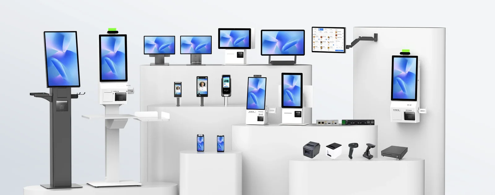
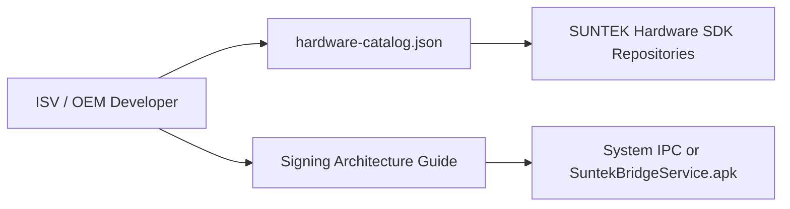

  <a href="https://www.suntekai.com">
    <picture>
      <source media="(prefers-color-scheme: dark)" srcset="./assets/logo-dark.png">
      <source media="(prefers-color-scheme: light)" srcset="./assets/logo-light.png">
      
    </picture>
  </a>

  <h1>SUNTEK Developer Documentation Portal</h1>

  

    <strong>Unified Hardware Architecture, Signing &amp; Protocol Guides</strong> &middot; <em>Enjoy Smarter Service</em> 
    Pure English technical documentation portal maintained by <strong>SUNTEK Technology Co., Ltd.</strong>
  

  

    
    
    
    
  

  

---

## Documentation Modules

<table>
  <tr>
    <td width="50%" valign="top">
      <h3>SDK Selection &amp; Signing</h3>
      
Map commercial hardware models to canonical <code>suntek-sdk-*</code> repositories and configure application signing certificates without ROM changes.

      <a href="./docs/getting-started/sdk-selection-and-signing-guide.md">Read SDK &amp; Signing Guide</a>
    </td>
    <td width="50%" valign="top">
      <h3>FL5 HTTP Attendance Protocol</h3>
      
BS Visible Light attendance &amp; access control HTTP protocol specification accompanied by a runnable Python mock test server.

      <a href="./docs/protocols/fl5-attendance-http-protocol.md">Protocol Spec</a> &middot; <a href="./tools/fl5-protocol-mock-server">Mock Server</a>
    </td>
  </tr>
  <tr>
    <td width="50%" valign="top">
      <h3>Peripherals &amp; Serial LED</h3>
      
Barcode scanner fill-light control commands and Kiosk WS2812B / UART HEX control frames (<code>/dev/ttyS5</code>, 9600 bps).

      <a href="./docs/peripherals/scanner-fill-light-commands.md">Scanner Light</a> &middot; <a href="./docs/peripherals/kiosk-led-serial-hex-protocol.md">Kiosk LED HEX</a>
    </td>
    <td width="50%" valign="top">
      <h3>Windows &amp; Linux Drivers</h3>
      
Windows Tablet/POS platform driver catalog (Intel Processor N150, SHA-256 verified) and Ubuntu CUPS raw USB receipt printing guide.

      <a href="./docs/drivers/tablet-pos-n150-windows-drivers.md">Windows Drivers (Intel N150)</a> &middot; <a href="./docs/linux/ubuntu-cups-usb-thermal-printer.md">Ubuntu CUPS</a>
    </td>
  </tr>
</table>

---

## Documentation Architecture Map

---

## Complete Document Index

- [`docs/getting-started/sdk-selection-and-signing-guide.md`](./docs/getting-started/sdk-selection-and-signing-guide.md) — Hardware SDK lookup & Application Signing Architecture
- [`docs/protocols/fl5-attendance-http-protocol.md`](./docs/protocols/fl5-attendance-http-protocol.md) — FL5 attendance & access control HTTP protocol
- [`docs/peripherals/scanner-fill-light-commands.md`](./docs/peripherals/scanner-fill-light-commands.md) — Barcode scanner fill-light control commands
- [`docs/peripherals/kiosk-led-serial-hex-protocol.md`](./docs/peripherals/kiosk-led-serial-hex-protocol.md) — Serial LED status light HEX protocol (`/dev/ttyS5`, 9600 bps)
- [`docs/drivers/tablet-pos-n150-windows-drivers.md`](./docs/drivers/tablet-pos-n150-windows-drivers.md) — Windows Tablet/POS driver package index (Intel Processor N150)
- [`docs/linux/ubuntu-cups-usb-thermal-printer.md`](./docs/linux/ubuntu-cups-usb-thermal-printer.md) — Ubuntu Linux CUPS raw USB printer setup guide
- [`hardware-catalog.json`](./hardware-catalog.json) — Machine-readable model-to-SDK catalog
- [`tools/fl5-protocol-mock-server/`](./tools/fl5-protocol-mock-server) — Python mock HTTP server for FL5 integration testing

---

## Technical Support

- Documentation Issues: [Open an Issue](https://github.com/SUNTEK-Official/.github/issues/new/choose)
- Email: [support@suntekai.com](mailto:support@suntekai.com)

---

  
    
  <strong>SUNTEK Technology Co., Ltd.</strong> &mdash; <em>Smart Commercial Terminal Hardware Manufacturer Since 2010</em> 
  80+ Export Countries &middot; 5,000,000+ Terminals Shipped &middot; ISO 9001 / ISO 27001 / CE / RoHS

