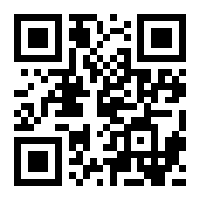
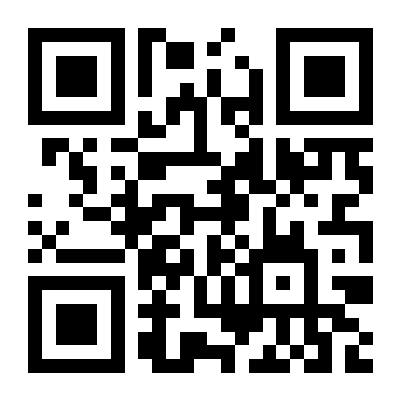
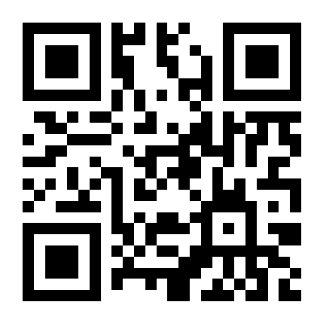
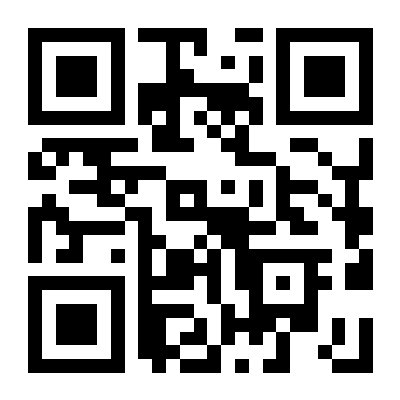

# Scanner Light Control Manual

## Overview

This document describes the commands for turning on and off the left and right lights of the scanner.

## Command List

### Right Light Control

| Command | Image | Function |
|---------|-------|----------|
| S_CMD_03A2 |  | Turn on scanner right light |
| S_CMD_03A0 |  | Turn off scanner right light |

### Left Light Control

| Command | Image | Function |
|---------|-------|----------|
| S_CMD_03L2 |  | Turn on scanner left light |
| S_CMD_03L0 |  | Turn off scanner left light |

## Command Naming Convention

- **A** Series: Controls right (Right/Auxiliary) light
  - `03A2` - Turn on (digit 2 indicates ON)
  - `03A0` - Turn off (digit 0 indicates OFF)

- **L** Series: Controls left light
  - `03L2` - Turn on (digit 2 indicates ON)
  - `03L0` - Turn off (digit 0 indicates OFF)

## Use Cases

1. **Fill Light Control**: Independently control left and right fill lights based on ambient light conditions
2. **Power Saving Mode**: Use single-sided light to reduce power consumption
3. **Special Scanning Scenarios**: Certain scanning scenarios may require single-sided illumination

## Notes

- Left and right lights can be controlled independently without interference
- Select appropriate light configuration based on actual scanning requirements
- Turn off lights when not in use for extended periods to save power
